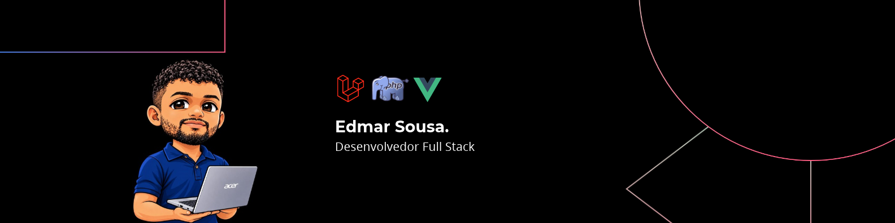

## Olá, me chamo Edmar.

Sou Desenvolvedor Full-Stack com +4 anos de experiência em PHP, Laravel, JavaScript, TypeScript, NestJS e Vue.js.
Busco atuar como Desenvolvedor Full-Stack, com foco em sistemas distribuídos, performance, escalabilidade e modernização de sistemas legados.
Gosto de construir soluções bem estruturadas, priorizando otimizações, estruturas de dados e boas práticas. 
Sou curioso e estou sempre aberto a aprender novas tecnologias e novas areas.

### Tecnologias

  
  

### Projetos

### buy-a-ticket

**Descrição:** Uma API REST para compra de ingressos. O objetivo do projeto é trabalhar com concorrência, impedindo que o mesmo ingresso seja vendido para mais de uma pessoa.

**Tecnologias:** PHP, Phalcon, PostgreSQL, Docker e Nginx.

**Repositório:** [buy-a-ticket](https://github.com/Edmar-Sousa/buy-a-ticket)

### Kanban

**Descrição:** Projeto desenvolvido como laboratório de aprendizado. Nele, exploro integrações com APIs de pagamento, testes unitários e E2E, processamento de filas e comunicação em tempo real utilizando WebRTC e Laravel Reverb. O projeto ainda está em desenvolvimento.

**Tecnologias:** PHP, Laravel, Laravel Reverb, JavaScript, Vue.js, Inertia.js e Tailwind CSS.

**Repositório:** [Kanban](https://github.com/Edmar-Sousa/kanban)

### Rinha de Backend

**Descrição:** Projeto desenvolvido para o evento Rinha de Backend 2024. O objetivo era criar uma API REST para operações de débito e crédito em contas de usuários, sob restrições severas de memória e CPU: 550 MB de memória e 1,5 CPU.

**Tecnologias:** PHP, Hyperf, PostgreSQL, Docker e Nginx.

**Repositório:** [rinha-backend-2024q1](https://github.com/Edmar-Sousa/rinha-backend-2024q1)

### Atualmente

- Estudando arquitetura de software e desenvolvimento back-end.
- Desenvolvendo projetos de sistemas distribuídos, com foco em sistemas financeiros.
- Buscando oportunidades como desenvolvedor full-stack ou back-end.

### Contatos

